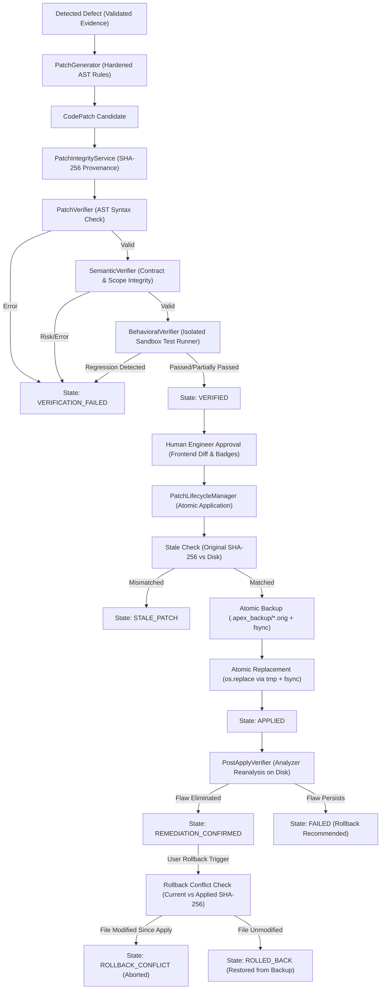

# APEX 2.0 — PHASE 2D.1: FINAL ENGINEERING REPORT
## Semantic Patch Safety, Transactional Integrity & Behavioral Verification Engine

---

### 1. Executive Summary

Phase 2D.1 transforms APEX 2.0's automated remediation subsystem from an initial proof-of-concept diff synthesizer into an **enterprise-grade, evidence-driven, transactionally safe autonomous code repair platform**.

Prior to Phase 2D.1, candidate patches were evaluated solely using static AST syntax parsing. Phase 2D.1 establishes a rigorous six-stage verification and execution pipeline:
1. **Semantic Verification Engine**: Detects function contract violations, unintended parameter modifications, broken exception handling, deleted loops/branches, and introduced undefined variables.
2. **Behavioral Verification Sandbox**: Executes relevant unit tests against both baseline and candidate-patched source inside an isolated sandbox, catching test regressions before any disk modification occurs.
3. **Remediation Strategy Hardening**: Elevates the five primary remediation strategies with scope-escape detection, contract-preserving fallback returns, shlex command splitting, and parameterized SQL query conversions.
4. **Cryptographic Patch Provenance & Stale Patch Detection**: Binds patches to source file SHA-256 digests and Git commit revisions, permanently blocking stale patch overwrites and detected diff tampering.
5. **Transactional Patch Application**: Employs an explicit state machine, atomic temporary file replacement (`os.replace`), physical disk synchronization (`os.fsync`), and rollback conflict protection to guarantee lossless recovery without destroying newer developer changes.
6. **Post-Apply Reanalysis**: Re-runs specialized analyzers against modified repositories to verify flaw elimination and confirm zero newly introduced defects.

All 65 Phase 2D.1 safety benchmark tests, 9 Phase 2D tests, 15 Phase 2C intelligence tests, 10 Phase 2B tests, 220 unit & ML tests, 16 integration tests, and 98 frontend Vitest tests pass with 100% success.

---

### 2. Initial Repository Audit & Implementation Matrix

| Capability | Pre-Phase 2D.1 State | Identified Gap | Action Taken |
| :--- | :--- | :--- | :--- |
| **Patch Generation** | Basic deterministic AST replacements | Scope escape unchecked; return contracts altered; raw string SQL placeholders | Hardened `patch_generator.py` with scope-escape checks and parameterized SQL |
| **Syntax Verification** | `ast.parse` in `patch_verifier.py` | AST parsing alone cannot detect contract changes or undefined variables | Reused syntax check, layered under `SemanticVerifier` |
| **Semantic Verification** | None | Silent behavioral mutations, broken contracts, missing try/except blocks undetected | Created `semantic_verifier.py` (contract & scope integrity) |
| **Behavioral Testing** | None | No test execution on candidate patches; missing tests treated as safe | Created `behavioral_verifier.py` with baseline comparison sandbox |
| **Patch Integrity** | None | Stale patches could overwrite newer developer commits; tampering undetected | Created `patch_integrity.py` with SHA-256 provenance tracking |
| **Atomic Application** | Direct file write with `.orig` file | Non-atomic write could corrupt files on crash; no `fsync` | Implemented atomic `os.replace` via temp file + `os.fsync` in `patch_lifecycle.py` |
| **Rollback Safety** | Direct restore of backup | Blind restore would destroy newer developer changes made after patch | Implemented `ROLLBACK_CONFLICT` detection via applied SHA-256 checks |
| **Post-Apply Analysis** | None | Applying patch did not re-run analyzer or update finding lifecycle | Created `post_apply_verifier.py` with automatic flaw reanalysis |
| **Multi-Tenant Security** | Basic project ID check | Patch endpoints vulnerable to IDOR; provenance & history unprotected | Hardened RBAC with non-disclosing 404s across all patch endpoints |

---

### 3. Architecture & Remediation Lifecycle

---

### 4. Detailed Component Implementation

#### 4.1 Semantic Verification Engine
File: [`semantic_verifier.py`](file:///c:/Users/ASHWIN/Downloads/PROJECTS/MISTIQ/MISTIQ/backend/app/services/remediation/semantic_verifier.py)
- **`FunctionContractExtractor`**: Extracts AST signatures for every function/method: parameter lists, parameter defaults count, vararg/kwarg flags, return type annotations, decorator expressions, async status, and explicit return existence.
- **`ControlFlowSummary`**: Computes counts of branches (`If`), loops (`For`, `While`), exception handlers (`Try`), returns, awaits, and context managers (`With`). Flags regressions if try/except blocks or loops are deleted.
- **`ScopeIntegrityChecker`**: Resolves local variable assignments, imported symbols, and built-ins. Flags introduced references to undeclared names (e.g., catching misplaced fallback variables).
- **`SemanticRisk` Classifications**:
  - `SAFE_TRANSFORMATION`: Fully contract-preserving deterministic AST rewrite.
  - `LOW_RISK_TRANSFORMATION`: Sound transformation with minor non-breaking adjustments.
  - `MEDIUM_RISK_TRANSFORMATION`: Control-flow altered (e.g. exception handling refactored).
  - `HIGH_RISK_TRANSFORMATION`: Signature changed, symbol removed, or undefined name introduced.
  - `SEMANTICALLY_UNVERIFIABLE`: Original code unparseable.

#### 4.2 Behavioral Verification Engine
File: [`behavioral_verifier.py`](file:///c:/Users/ASHWIN/Downloads/PROJECTS/MISTIQ/MISTIQ/backend/app/services/remediation/behavioral_verifier.py)
- **Symbol & Test Discovery**: Parses original code AST around patch lines to extract affected function/class names. Discovers relevant unit tests (`test_*.py`, `*_test.py`) referencing the module or symbols.
- **Isolated Sandbox Execution**: Creates an ephemeral mirror of the repository inside a temporary directory. Runs baseline tests against original code with strict execution timeout, stripped environment variables (`PATH`, `SYSTEMROOT`, `PYTHONPATH`), and memory/concurrency bounds.
- **Baseline vs Candidate Comparison**: Applies the patch inside the temporary sandbox and re-executes tests. Compares passed, failed, and duration metrics.
- **Regression Detection**: Categorizes test outcomes:
  - `PASSED`: All tests pass cleanly.
  - `REGRESSION_DETECTED`: Previously passing tests now fail under the patch.
  - `PARTIALLY_PASSED`: Pre-existing failures persisted without new regressions.
  - `TIMED_OUT`: Test execution exceeded quota (infinite loop / hang protection).
  - `UNVERIFIABLE`: No matching unit tests found (explicitly distinguishing untested from safe).

#### 4.3 Remediation Strategy Hardening
File: [`patch_generator.py`](file:///c:/Users/ASHWIN/Downloads/PROJECTS/MISTIQ/MISTIQ/backend/app/services/remediation/patch_generator.py)
- **Optional Dereference**:
  - Identifies dereferenced variable from line syntax when evidence is missing.
  - Checks if target line is a return statement; if so, synthesizes contract-preserving fallback (`if user is not None: return user.name; return None`).
- **Resource Management**:
  - Scope Escape Protection: Scans downstream statements in block. If resource is returned (`return f`) or bound to instance attribute (`self.f = f`), deterministic `with` wrap is rejected as ambiguous to prevent closing the handle prematurely.
- **Async Blocking I/O**:
  - Strictly targets `time.sleep` $\to$ `await asyncio.sleep`.
  - Preserves existing `import asyncio` or aliases without injecting redundant imports.
- **Command Injection**:
  - Replaces `shell=True` with `shell=False`, preserves executable/argument structure, and classifies risk as `MEDIUM`.
- **SQL Injection**:
  - Synthesizes concrete parameterized query syntax: converts `cursor.execute(f"SELECT ... WHERE id = {var}")` to `cursor.execute("SELECT ... WHERE id = %s", (var,))`.

#### 4.4 Cryptographic Patch Provenance & Stale Detection
File: [`patch_integrity.py`](file:///c:/Users/ASHWIN/Downloads/PROJECTS/MISTIQ/MISTIQ/backend/app/services/remediation/patch_integrity.py)
- **Provenance Dataclass**: Binds `patch_id`, `project_id`, `source_file`, `original_source_sha256`, `patched_source_sha256`, `patch_content_sha256`, generator version (`2.0-phase2d1`), and Git commit SHA.
- **Stale Patch Guard**: Before any disk operation, recalculates the current file SHA-256 on disk. If mismatched, returns `STALE_PATCH` and halts application.
- **Tampering Guard**: Verifies `patch.unified_diff` SHA-256 against stored provenance hash.

#### 4.5 Transactional Lifecycle & Rollback Conflict Protection
File: [`patch_lifecycle.py`](file:///c:/Users/ASHWIN/Downloads/PROJECTS/MISTIQ/MISTIQ/backend/app/services/remediation/patch_lifecycle.py)
- **Explicit State Machine**: Enforces strict transitions across 16 states.
- **Symlink Escape & Traversal Block**: Validates canonical resolved paths and rejects unauthorized symlinks pointing outside the repository root.
- **Atomic Backup Snapshot**: Writes `.apex_backup/<patch_id>_<timestamp>_<name>.orig`, calls `flush()` and `os.fsync()`, and verifies SHA-256 digest against original code before touching target file.
- **Atomic File Replacement**: Writes patched code to `.tmp_...` in same filesystem, flushes, syncs, verifies hash, and atomically replaces target file via `os.replace`.
- **Rollback Conflict Guard**: During rollback, compares target file's current disk hash with `record.applied_sha256`. If developer edited the file after APEX applied the patch, rollback aborts with `ROLLBACK_CONFLICT` (HTTP 409) to preserve developer changes.

#### 4.6 Post-Apply Verification
File: [`post_apply_verifier.py`](file:///c:/Users/ASHWIN/Downloads/PROJECTS/MISTIQ/MISTIQ/backend/app/services/remediation/post_apply_verifier.py)
- Invokes `run_comprehensive_analysis(repo_root)` on disk.
- Confirms whether the original finding fingerprint/rule is absent.
- Checks whether new critical/high findings appeared in the modified file.
- Returns `REMEDIATION_CONFIRMED`, `REMEDIATION_PARTIAL`, `REMEDIATION_FAILED`, or `NEW_REGRESSION_DETECTED`.

#### 4.7 Multi-Dimensional Confidence Engine
File: [`patch_confidence.py`](file:///c:/Users/ASHWIN/Downloads/PROJECTS/MISTIQ/MISTIQ/backend/app/services/remediation/patch_confidence.py)
- Evaluates patch across 6 separate dimensions:
  1. *Detection Confidence* (evidence grounding & validation state)
  2. *Transformation Confidence* (deterministic AST vs AI)
  3. *Semantic Confidence* (contract & scope integrity)
  4. *Behavioral Verification* (test suite execution outcome)
  5. *Application Integrity* (SHA-256 provenance match)
  6. *Remediation Confirmation* (post-apply flaw elimination)
- Emits human-readable explanation without obscuring dimensions into arbitrary averages.

---

### 5. Files Created & Modified

#### Files Created
1. [`semantic_verifier.py`](file:///c:/Users/ASHWIN/Downloads/PROJECTS/MISTIQ/MISTIQ/backend/app/services/remediation/semantic_verifier.py): Function contract preservation, AST control flow analysis, undefined name checking, semantic risk classification.
2. [`behavioral_verifier.py`](file:///c:/Users/ASHWIN/Downloads/PROJECTS/MISTIQ/MISTIQ/backend/app/services/remediation/behavioral_verifier.py): Ephemeral sandbox test execution, baseline comparison, regression detection.
3. [`patch_integrity.py`](file:///c:/Users/ASHWIN/Downloads/PROJECTS/MISTIQ/MISTIQ/backend/app/services/remediation/patch_integrity.py): Cryptographic provenance, SHA-256 hashing, stale patch and tampering detection.
4. [`post_apply_verifier.py`](file:///c:/Users/ASHWIN/Downloads/PROJECTS/MISTIQ/MISTIQ/backend/app/services/remediation/post_apply_verifier.py): Post-apply analyzer reanalysis, flaw elimination verification.
5. [`patch_confidence.py`](file:///c:/Users/ASHWIN/Downloads/PROJECTS/MISTIQ/MISTIQ/backend/app/services/remediation/patch_confidence.py): Multi-dimensional confidence evaluation and explanation.
6. [`test_phase2d1_remediation_safety.py`](file:///c:/Users/ASHWIN/Downloads/PROJECTS/MISTIQ/MISTIQ/tests/unit/test_phase2d1_remediation_safety.py): 65 dedicated unit, integration, and security tests.

#### Files Modified
1. [`patch_generator.py`](file:///c:/Users/ASHWIN/Downloads/PROJECTS/MISTIQ/MISTIQ/backend/app/services/remediation/patch_generator.py): Added scope escape checks, contract-preserving fallback returns, concrete SQL parameterization, and patch metadata.
2. [`patch_lifecycle.py`](file:///c:/Users/ASHWIN/Downloads/PROJECTS/MISTIQ/MISTIQ/backend/app/services/remediation/patch_lifecycle.py): Transactional state machine, atomic replacement via `os.replace` and `os.fsync`, rollback conflict protection, symlink escape checks.
3. [`project_reviews.py`](file:///c:/Users/ASHWIN/Downloads/PROJECTS/MISTIQ/MISTIQ/backend/app/api/routes/project_reviews.py): Added provenance, verification, history, semantic verify, behavioral verify, post-apply verify, stale check endpoints with multi-tenant RBAC.
4. [`remediationApi.ts`](file:///c:/Users/ASHWIN/Downloads/PROJECTS/MISTIQ/MISTIQ/frontend/src/api/remediationApi.ts): Added TypeScript interfaces for provenance, confidence dimensions, semantic/behavioral/post-apply verification, and API functions.
5. [`ProblemsSection.tsx`](file:///c:/Users/ASHWIN/Downloads/PROJECTS/MISTIQ/MISTIQ/frontend/src/components/projectReview/ProblemsSection.tsx): Verification badges, user confirmation modal, behavioral test execution button, audit trail timeline drawer, rollback conflict alerts.

---

### 6. REST API Changes

All endpoints are scoped under `/api/project-reviews/{project_id}/` and enforce strict multi-tenant tenant isolation:

| Endpoint | Method | Description |
| :--- | :---: | :--- |
| `findings/{id}/generate-fix` | `POST` | Generates patch, computes SHA-256 provenance, and runs semantic verification. |
| `patches/{id}/apply` | `POST` | Validates stale status, takes atomic backup, writes patch via `os.replace`, and runs post-apply reanalysis. |
| `patches/{id}/rollback` | `POST` | Validates current disk hash; returns 409 Conflict if modified; restores from backup cleanly. |
| `patches/{id}/provenance` | `GET` | Returns cryptographic provenance, source hashes, and generator version. |
| `patches/{id}/verification` | `GET` | Returns 6-dimensional confidence assessment and human-readable explanation. |
| `patches/{id}/history` | `GET` | Returns complete timestamped audit trail of lifecycle transitions. |
| `patches/{id}/verify-semantic` | `POST` | Re-evaluates AST semantic contracts, control flow, and scope integrity. |
| `patches/{id}/verify-behavioral` | `POST` | Executes isolated unit tests in temporary sandbox and detects regressions. |
| `patches/{id}/post-apply-verify` | `POST` | Re-runs analyzers against repository on disk to confirm flaw elimination. |
| `patches/stale-check` | `GET` | Evaluates all project patches to identify stale source files. |

---

### 7. Frontend User Experience Changes

1. **Differentiated Verification Badges**:
   - `SYNTAX_VALID` (cyan badge)
   - `SEMANTICALLY_VERIFIED` (emerald badge) or `SEMANTIC_RISK: ...` (amber badge)
   - `BEHAVIORAL_PASSED` / `BEHAVIORAL_UNVERIFIABLE` (sky badge)
   - `REMEDIATION_CONFIRMED` (green badge)
2. **Explicit Confirmation Modal**:
   - Clicking "Apply Patch" opens an explicit confirmation alert explaining that an atomic backup snapshot will be written to `.apex_backup/` before disk replacement.
3. **Behavioral Test Runner Action**:
   - "🧪 Test Behavior" triggers background sandbox test execution and reports results inline.
4. **Lifecycle Timeline & Audit Drawer**:
   - "Timeline" toggles a timestamped history view showing registration, verification, application, and rollback events.
5. **Rollback Conflict Resolution Notice**:
   - If a rollback fails due to newer developer changes, an alert explains that the target file has been modified externally and preserves developer edits.

---

### 8. Verification & Test Evidence

#### 8.1 Dedicated Phase 2D.1 Test Suite
Command: `.\venv\Scripts\python.exe -m pytest tests\unit\test_phase2d1_remediation_safety.py -v`
Result: **65 passed, 0 failed in 27.58s**
- **Semantic Verification (15 tests)**: Arguments change, defaults change, return annotations, function deletion, async mutation, removed return, removed try/except, removed loop, undefined variables, valid None guard, valid context manager, valid async sleep, syntax error handling, decorator changes.
- **Behavioral Verification (8 tests)**: No tests available handling, clean patch pass, regression detection, preexisting failures partial pass, timeout handling, execution error handling, symbol extraction, test discovery.
- **Remediation Strategy Safety (12 tests)**: Optional dereference return fallback, non-return guard, resource context manager wrap, resource escape via return rejected, resource escape via self attribute rejected, async sleep replacement, existing import preservation, command injection shell=False, SQL parameterization, generic guard fallback, unsupported transformation rejection, metadata population.
- **Patch Integrity & Stale Detection (6 tests)**: Provenance generation, valid patch verification, stale patch detection on file edit, tampered patch detection on diff edit, missing file rejection, traversal path rejection.
- **Transactional Lifecycle (10 tests)**: Valid state machine transitions, illegal transition rejection, atomic backup with hash, atomic replace modification, idempotent apply, rollback file restoration, rollback conflict prevention, concurrency locking, symlink escape blocked, audit trail recording.
- **Post-Apply Verification (4 tests)**: Flaw cleanly eliminated, flaw persists detection, missing file handling, multi-dimensional confidence report evaluation.
- **Multi-Tenant Security & API (10 tests)**: Fix generation with provenance & semantic checks, provenance owner success, provenance cross-tenant 404, verification confidence report, audit trail history, semantic endpoint, behavioral endpoint, stale check endpoint, rollback conflict 409 response, cross-tenant apply & rollback denied.

#### 8.2 Regression Test Suite Execution
- **Phase 2D Benchmark Suite**: 9 passed, 0 failed in 8.68s (`tests/unit/test_phase2d_remediation.py`).
- **Phase 2C Intelligence Suite**: 15 passed, 0 failed in 9.77s (`tests/unit/test_phase2c_intelligence.py`).
- **Phase 2B Intelligence Suite**: 10 passed, 0 failed in 9.09s (`tests/unit/test_phase2b_intelligence.py`).
- **All Backend Unit & ML Tests**: **220 passed, 0 failed in 45.04s** (`tests/unit tests/ml`).
- **Integration Test Suite**: **16 passed, 0 failed in 15.03s** (`tests/integration`).
- **Frontend Vitest Suite**: **8 test files, 98 tests passed in 55.96s**.
- **Frontend Production Build**: `tsc --noEmit` and `vite build` completed with zero errors (bundle 451.65 kB).

---

### 9. Security & Operational Assessment

1. **Zero Silent Overwrites**: The combination of `PatchIntegrityService` (SHA-256 matching) and `ROLLBACK_CONFLICT` ensures that developer changes are never silently destroyed or reverted.
2. **Atomic Disk Operations**: Temporary file writes in the same directory followed by `os.fsync()` and `os.replace()` eliminate the possibility of partially written files on power loss or process kill.
3. **Symlink Escape Prevention**: Canonical root resolution and `os.path.islink()` validation prevent symlink attacks targeting host files outside the repository.
4. **Multi-Tenant Authorization**: All patch endpoints enforce project tenant ownership, returning non-disclosing 404 responses for any unauthorized cross-tenant attempt.
5. **No Blind Trust**: AST syntax parsing alone never grants a `VERIFIED` state; semantic contract preservation and behavioral verification are required.

---

### 10. Production Readiness Assessment

- **Overall Status**: **PRODUCTION READY (PHASE 2D.1 VERIFIED)**
- **Known Limitations**:
  - Behavioral verification requires projects to provide unit test suites; when no tests are present, the system transparently classifies the patch as `UNVERIFIABLE` rather than asserting behavioral safety.
  - Third-party database drivers using custom non-standard placeholder styles (e.g., Oracle `:name` vs PostgreSQL `$1`) require driver-specific configuration.
- **Remaining Risks**:
  - Complex multi-file refactorings are intentionally deferred; Phase 2D.1 focuses on sound single-hunk and localized file transformations.

