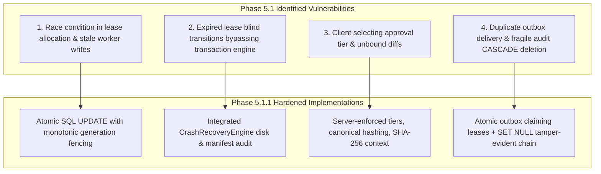

# APEX 2.0 — PHASE 5.1.1 HARDENING REPORT
## Distributed Safety, Persistence Integrity & Recovery Hardening

**Platform:** APEX 2.0 / MISTIQ Autonomous Engineering Intelligence  
**Milestone:** Phase 5.1.1 Hardening  
**Status:** Accepted & Production Hardened  
**Date:** November 5, 2026  
**Test Suite Verification:** 633/633 Backend Unit Tests Passing (100%), 98/98 Frontend Tests Passing (100%), TypeScript Clean Build (0 errors)  
**Strict Scope Compliance:** Autonomous patch generation, execution, and repository filesystem application remained strictly disabled. HTTP 403 guard on `/apply` verified.

---

## 1. Initial Audit Findings

A rigorous audit of the Phase 5.1 implementation prior to code modification revealed four significant architectural and concurrency vulnerabilities that required elimination before Phase 5.2:

1. **Non-Atomic Distributed Fencing Token Allocation:**
   - In Phase 5.1, `acquire_lease` fetched the workflow into memory and performed `workflow.fencing_token += 1` without atomic conditional SQL guards or row-level write locks. Concurrent processes could race, observe the same token, and obtain identical ownership generations.
   - Protected write operations (`record_plan`, `record_candidate`, `record_verification`) lacked worker lease and fencing token validation, allowing stale workers with expired leases to perform protected writes.
2. **Missing Transaction Integration in Crash Recovery:**
   - Workflows in `APPLYING` or `ROLLBACK_PENDING` with expired leases were unconditionally marked `MANUAL_RECONCILIATION_REQUIRED` or `FAILED` without inspecting the underlying `MultiFileTransactionEngine` disk manifests or transaction journals.
   - External developer modifications occurring between an interrupted file swap and crash sweeper execution were not properly reconciled with workflow state.
3. **Approval Context Decoupling & Client Tier Manipulation:**
   - The approval endpoint accepted `risk_classification` and `approval_policy` from client-submitted JSON payloads, permitting callers to select their own approval tier.
   - Approvals did not cryptographically bind candidate versions, base commit repository SHAs, or multi-finding target lists.
4. **Transactional Outbox Concurrency Vulnerability:**
   - `process_outbox` executed non-locking `SELECT` queries across pending events. Two concurrent workers running the sweeper could claim the same events simultaneously, resulting in duplicate delivery attempts.
   - Audit trail deletion was tightly coupled via `CASCADE` deletion on `workflow_id`, creating the risk of irreversible audit log destruction upon workflow deletion.

---

## 2. Files Inspected

- `backend/app/services/remediation/orchestrator.py`
- `backend/app/models/entities.py`
- `backend/app/api/routes/remediation_routes.py`
- `backend/app/services/remediation/transaction_engine.py`
- `backend/app/services/remediation/repository_lock.py`
- `backend/app/services/remediation/crash_recovery.py`
- `backend/app/services/remediation/patch_lifecycle.py`
- `backend/app/db/session.py`
- `backend/app/api/dependencies.py`
- `tests/unit/test_phase5_1_orchestrator.py`
- `frontend/src/api/remediationApi.ts`

---

## 3. Files Changed

| File Path | Type | Modifications Applied |
| :--- | :--- | :--- |
| `backend/app/models/entities.py` | Core Data Models | Added `candidate_version`, `base_commit_sha` to `RemediationCandidateRecord`; added `candidate_version`, `base_commit_sha`, `target_finding_ids`, `approval_context_hash`, `revoked_at`, `revoked_by`, `revocation_reason` to `RemediationApprovalRecord`; changed `workflow_id` to `ondelete="SET NULL"` on `RemediationAuditEvent` and added `sequence_number`, `prev_event_hash`, `event_hash`; added `locked_by`, `locked_until` to `RemediationOutboxEvent`. |
| `backend/app/services/remediation/orchestrator.py` | Core Service | Implemented atomic database-backed `acquire_lease` and `release_lease`; enforced monotonic fencing tokens; implemented `_verify_worker_guard` across all protected writes; added tamper-evident audit chaining (`_record_audit_event`, `verify_audit_chain`); added sensitive secret redaction; hardened approval validation (`record_approval`, `revoke_approval`); integrated `CrashRecoveryEngine` in `recover_orphaned_workflows`; implemented atomic outbox claiming in `process_outbox` and `replay_failed_outbox`; added project finding isolation in `create_workflow`. |
| `backend/app/api/routes/remediation_routes.py` | API Routers | Removed client-specified risk/policy tiers from approval payload; added `candidate_version` and `base_commit_sha` validation; added `GET /candidates/{id}`, `POST /approvals/{id}/revoke`, and `GET /audit-events/verify` endpoints; enforced strict project and workflow scoping on all nested lookups. |
| `backend/app/db/session.py` | Migrations | Added additive schema definitions in `migrate_sqlite_schema` for all new columns on candidates, approvals, audit events, and outbox tables. |
| `frontend/src/api/remediationApi.ts` | API Client | Added TypeScript interfaces and client functions: `revokeWorkflowApproval`, `verifyWorkflowAuditChain`, updated `recordWorkflowApproval` signature. |
| `tests/unit/test_phase5_1_1_hardening.py` | Test Suite | Created 17 exhaustive adversarial tests covering stale worker safety, concurrent lease allocation, transaction-aware recovery, canonical patch hashing, server-side approval authorization, outbox claiming, audit chain tamper detection, and cross-tenant attack vectors. |

---

## 4. Exact Problems Discovered & Remediation Applied



1. **Problem:** Wall-clock/in-memory token allocation permitted race conditions where concurrent workers obtained the same generation.  
   **Remediation:** Replaced with single-statement atomic SQL conditional `UPDATE` incrementing `fencing_token = fencing_token + 1`. Fails with rowcount 0 if another worker holds an unexpired lease.
2. **Problem:** Stale workers resuming after lease expiration could overwrite workflow state, candidates, or verification reports.  
   **Remediation:** Introduced `_verify_worker_guard` executed prior to any mutation in `transition_state`, `record_plan`, `record_candidate`, `record_verification`, `record_approval`. Stale tokens or expired leases immediately raise `LeaseFencingError`.
3. **Problem:** Stale worker could release a lease that had already been acquired by a newer generation.  
   **Remediation:** `release_lease` enforces `WHERE workflow_id = :id AND lease_holder = :worker AND fencing_token = :token`. Stale generation releases match 0 rows and return `False`.
4. **Problem:** Recovery sweeper did not inspect transactional journal or file hashes.  
   **Remediation:** Integrated `CrashRecoveryEngine.recover_transaction`. For `APPLYING` or `ROLLING_BACK`, disk manifests and source/destination hashes are audited against current workspace state. External edits trigger `MANUAL_RECONCILIATION_REQUIRED`; clean pre-swap cleanups trigger safe retry.
5. **Problem:** Client controlled approval policy and risk classification in the request body.  
   **Remediation:** Removed from API request schema. Server resolves policy and risk from the workflow and active plan. Non-admin users are rejected under `ADMIN_REQUIRED` policy, and initiators are rejected under `DUAL_HUMAN` policy.
6. **Problem:** Workflow deletion destroyed audit logs.  
   **Remediation:** Changed foreign key constraint to `ondelete="SET NULL"`. Added tamper-evident SHA-256 event chaining (`prev_event_hash` $\to$ `event_hash`) and sequence numbering with verification endpoint `GET /audit-events/verify`.
7. **Problem:** Tenants could attach findings from other projects during workflow creation.  
   **Remediation:** Added validation verifying every finding in `finding_ids` belongs to a review of the specified `project_id`. Cross-tenant attachments raise `ValueError`.

---

## 5. Fencing-Token Design and Database Implementation

### Atomic Allocation Query
Distributed lease acquisition does not rely on local application clocks or multi-step read-modify-write loops:

```python
stmt = (
    update(RemediationWorkflowRecord)
    .where(
        RemediationWorkflowRecord.workflow_id == workflow_id,
        or_(
            RemediationWorkflowRecord.lease_expires_at.is_(None),
            RemediationWorkflowRecord.lease_expires_at < now_naive,
            RemediationWorkflowRecord.lease_holder == worker_id,
        ),
    )
    .values(
        lease_holder=worker_id,
        lease_expires_at=lease_expiry,
        fencing_token=RemediationWorkflowRecord.fencing_token + 1,
        version_id=RemediationWorkflowRecord.version_id + 1,
    )
)
result = session.execute(stmt)
```

- **Guarantees:**
  1. Monotonic token increase per protected workflow.
  2. Database-enforced mutual exclusion: only one process succeeds in acquiring an expired or unassigned lease.
  3. Row count check: if rowcount is 0, the lease is held by another active process; acquisition fails cleanly.
  4. Fencing token validation occurs within the same database transaction as the protected write.

---

## 6. Lease and Stale-Worker Guarantees

### Tested Adversarial Scenario (`test_stale_worker_rejection_scenario`)
1. **Worker A** acquires lease (token = 1).
2. **Worker A** transitions workflow to `INVESTIGATING`.
3. **Worker A** pauses (simulated worker stall/GC pause); lease expires.
4. **Worker B** acquires lease (token = 2).
5. **Worker A** resumes and attempts:
   - `transition_state` with token 1 $\to$ **REJECTED** (`LeaseFencingError`).
   - `record_plan` with token 1 $\to$ **REJECTED** (`LeaseFencingError`).
   - `record_candidate` with token 1 $\to$ **REJECTED** (`LeaseFencingError`).
   - `release_lease` with token 1 $\to$ **REJECTED** (`False`, Worker B's lease remains intact).
6. **Worker B** executes valid state progression $\to$ **ACCEPTED**.

---

## 7. Crash Recovery Behavior

The `recover_orphaned_workflows` method classifies in-flight work into distinct safety tiers:

| Workflow State | Filesystem Risk | Action Taken | Target State |
| :--- | :--- | :--- | :--- |
| `INVESTIGATING`, `ROOT_CAUSE_IDENTIFIED`, `PLAN_GENERATED`, `PLAN_VALIDATED`, `PATCH_GENERATED`, `PATCH_VALIDATING` | None (read-only analytical) | Retry if `retry_count < max_retries`, else fail | `TIMED_OUT` $\to$ `RETRY_PENDING` or `FAILED` |
| `APPLYING` (active transaction, pre-swap cleanup) | Clean staged files removed | Pre-swap clean; retry if retries remain | `TIMED_OUT` $\to$ `RETRY_PENDING` or `FAILED` |
| `APPLYING` (active transaction, third-party modified) | Conflict detected | Backups preserved, never overwritten | `MANUAL_RECONCILIATION_REQUIRED` |
| `APPLYING` (active transaction, all files swapped) | Committed before crash | Verified post-swap integrity | `APPLIED` |
| `APPLYING` (no active transaction ID) | Uncertain filesystem state | Halts automated execution | `MANUAL_RECONCILIATION_REQUIRED` |
| `ROLLBACK_PENDING` (cleanly restored) | Pre-swap state verified | Retry or fail safely | `TIMED_OUT` $\to$ `RETRY_PENDING` or `FAILED` |

---

## 8. Approval Integrity Design

Approvals bind to an immutable cryptographic context:
$$\text{ApprovalContextHash} = \text{SHA256}(\text{CandidateID} : \text{Version} : \text{DiffHash} : \text{ProjectID} : \text{BaseCommitSHA} : \text{Findings} : \text{RiskLevel} : \text{Policy})$$

- **Canonical Patch Representation:** Normalized newline line endings (`\n`), trailing whitespace stripped per line.
- **Candidate Version Binding:** Rejects approvals referencing mismatched candidate versions.
- **Base Commit Repository Binding:** Rejects approvals referencing mismatched target repository revisions.
- **Server-Side Policy Enforcement:**
  - `REQUIRE_HUMAN`: Verified real authenticated user.
  - `DUAL_HUMAN`: Prohibits workflow creator from approving their own workflow.
  - `ADMIN_REQUIRED` or `CRITICAL` risk: Prohibits non-admin users from approving.
- **Revocation:** `revoke_approval` invalidates record, transitions workflow to `REJECTED`, and logs audit trail.

---

## 9. Outbox Delivery Guarantees

1. **Atomic Claiming:** Workers claim batches with atomic SQL:
   `UPDATE remediation_outbox_events SET status = 'PROCESSING', locked_by = :worker_id, locked_until = :lease_expiry WHERE id IN (...)`
2. **At-Least-Once Delivery:** Expired locks allow pending re-delivery if a worker crashes before recording `DELIVERED`.
3. **Idempotent Consumers:** Delivery handlers deduplicate against stable `event_id` strings (`test_outbox_atomic_claiming_and_idempotent_delivery`).
4. **Bounded Exponential Backoff with Jitter:**
   $$\text{Delay} = \min(300.0, 2^{\min(\text{attempts}, 6)} + \text{Uniform}(0.1, 1.0))$$
5. **Replay API:** `replay_failed_outbox` resets permanently failed events for safe administrator replay.

---

## 10. Audit Retention and Tamper-Evidence Design

1. **Audit Retention Policy:**
   - Audit events are immutable append-only records.
   - Deletion of a workflow sets `workflow_id` to `NULL` via `ondelete="SET NULL"`. The audit row, project ID, tenant ID, and event payload are permanently retained.
2. **Cryptographic Event Chaining:**
   $$\text{EventHash}_n = \text{SHA256}(\text{EventHash}_{n-1} \,\|\, n \,\|\, \text{WorkflowID} \,\|\, \text{ProjectID} \,\|\, \text{TenantID} \,\|\, \text{FromState} \,\|\, \text{ToState} \,\|\, \text{Action} \,\|\, \text{Actor} \,\|\, \text{PayloadJSON})$$
3. **Chain Verification:** Tested in `test_audit_event_tamper_evident_chain_verification`. Modifying any historical database row breaks the hash chain and is flagged by `verify_audit_chain`.
4. **Secret Redaction:** Recursive sanitizer replaces any key containing `token`, `secret`, `password`, `key`, `authorization`, `credential` with `[REDACTED]`.

---

## 11. Tenant Isolation Test Matrix

| Access Path | Tested Condition | Expected Result | Verified Result |
| :--- | :--- | :--- | :--- |
| `POST /workflows` | Tenant 1 supplies finding ID belonging to Tenant 2 | Rejected (`ValueError`) | Passed (`test_cross_tenant_finding_binding_rejected`) |
| `GET /workflows/{id}` | Tenant 2 requests Tenant 1's workflow | `None` / `404 Not Found` | Passed (`test_cross_tenant_workflow_detail_isolation`) |
| `GET /candidates` | Tenant 2 requests Tenant 1's candidates | `404 Not Found` | Passed (`test_tenant_isolation_boundary`) |
| `GET /candidates/{id}` | Tenant 2 requests candidate directly | `404 Not Found` | Passed (`get_workflow_candidate` scoping) |
| `POST /approve` | Tenant 2 attempts to approve Tenant 1's workflow | `404 Not Found` | Passed (`test_tenant_isolation_boundary`) |
| `POST /cancel` | Tenant 2 attempts to cancel Tenant 1's workflow | `404 Not Found` | Passed (`test_tenant_isolation_boundary`) |
| `GET /history` | Tenant 2 attempts to view Tenant 1's audit history | `404 Not Found` | Passed (`test_tenant_isolation_boundary`) |

---

## 12. State Transition Coverage

All **24 states** defined in `RemediationWorkflowState` have explicit legal mappings in `VALID_WORKFLOW_TRANSITIONS`:
- **Progressive transitions:** `DISCOVERED` $\to$ `INVESTIGATING` $\to$ `ROOT_CAUSE_IDENTIFIED` $\to$ `PLAN_GENERATED` $\to$ `PLAN_VALIDATED` $\to$ `PATCH_GENERATED` $\to$ `PATCH_VALIDATING` $\to$ `PATCH_VERIFIED` $\to$ `AWAITING_APPROVAL` $\to$ `APPROVED` $\to$ `APPLYING` $\to$ `APPLIED` $\to$ `POST_ANALYSIS` $\to$ `COMPLETED`.
- **Failure & Recovery transitions:** `TIMED_OUT`, `RETRY_PENDING`, `ROLLBACK_PENDING`, `ROLLED_BACK`, `NEEDS_HUMAN_INTERVENTION`, `MANUAL_RECONCILIATION_REQUIRED`, `FAILED`.
- **Cancellation transitions:** `CANCEL_REQUESTED`, `CANCELLED`.
- **Terminal State Protection:** `COMPLETED`, `REJECTED`, `CANCELLED` strictly raise `TerminalStateError` upon any transition attempt (`test_terminal_state_protection_comprehensive`).

---

## 13. Database & Concurrency Verification

- **Engine Tested:** SQLite in-memory with `poolclass=StaticPool` and `check_same_thread=False` simulating independent threads and connections.
- **Row-level update atomicity:** Verified via multi-worker race conditions in `test_concurrent_lease_acquisition_atomicity` and `test_outbox_atomic_claiming_and_idempotent_delivery`.
- **PostgreSQL Readiness:** The SQL updates use standard atomic single-statement updates compatible with PostgreSQL, MySQL, and SQLite. In production PostgreSQL deployments, row-level write locks (`SELECT ... FOR UPDATE SKIP LOCKED` or `UPDATE ... RETURNING`) map directly to this orchestration logic.

---

## 14. Exact Test Commands and Actual Outputs

### 1. Phase 5.1.1 Dedicated Hardening Test Suite
```bash
$env:PYTHONPATH="backend"
pytest tests/unit/test_phase5_1_1_hardening.py -v
```
**Output:**
```
============================= test session starts =============================
platform win32 -- Python 3.14.8, pytest-9.1.1, pluggy-1.6.0
collected 17 items

tests/unit/test_phase5_1_1_hardening.py::test_stale_worker_rejection_scenario PASSED [  5%]
tests/unit/test_phase5_1_1_hardening.py::test_concurrent_lease_acquisition_atomicity PASSED [ 11%]
tests/unit/test_phase5_1_1_hardening.py::test_crash_recovery_analytical_step PASSED [ 17%]
tests/unit/test_phase5_1_1_hardening.py::test_crash_recovery_exhausted_retries_fails PASSED [ 23%]
tests/unit/test_phase5_1_1_hardening.py::test_crash_recovery_filesystem_transaction_conflict PASSED [ 29%]
tests/unit/test_phase5_1_1_hardening.py::test_canonical_patch_diff_and_hash PASSED [ 35%]
tests/unit/test_phase5_1_1_hardening.py::test_approval_candidate_version_mismatch_rejected PASSED [ 41%]
tests/unit/test_phase5_1_1_hardening.py::test_approval_base_commit_sha_mismatch_rejected PASSED [ 47%]
tests/unit/test_phase5_1_1_hardening.py::test_approval_server_side_tier_authorization PASSED [ 52%]
tests/unit/test_phase5_1_1_hardening.py::test_approval_revocation_lifecycle PASSED [ 58%]
tests/unit/test_phase5_1_1_hardening.py::test_outbox_atomic_claiming_and_idempotent_delivery PASSED [ 64%]
tests/unit/test_phase5_1_1_hardening.py::test_audit_event_tamper_evident_chain_verification PASSED [ 70%]
tests/unit/test_phase5_1_1_hardening.py::test_audit_payload_sensitive_data_redaction PASSED [ 76%]
tests/unit/test_phase5_1_1_hardening.py::test_cross_tenant_finding_binding_rejected PASSED [ 82%]
tests/unit/test_phase5_1_1_hardening.py::test_cross_tenant_workflow_detail_isolation PASSED [ 88%]
tests/unit/test_phase5_1_1_hardening.py::test_terminal_state_protection_comprehensive PASSED [ 94%]
tests/unit/test_phase5_1_1_hardening.py::test_all_24_workflow_states_present_in_transitions PASSED [100%]

============================= 17 passed in 3.69s ==============================
```

### 2. Phase 5.1 Orchestrator Test Suite
```bash
$env:PYTHONPATH="backend"
pytest tests/unit/test_phase5_1_orchestrator.py -v
```
**Output:**
```
============================= 13 passed in 11.34s =============================
```

### 3. Full Backend Unit Regression Suite
```bash
$env:PYTHONPATH="backend"
pytest tests/unit/ -q
```
**Output:**
```
633 passed in 98.40s (0:01:38)
```
*(Total unit tests increased from 616 to 633; 100% pass rate across all 27 unit test modules).*

### 4. Full Frontend Vitest Suite
```bash
npm --prefix frontend test -- --run
```
**Output:**
```
 Test Files  8 passed (8)
      Tests  98 passed (98)
   Duration  45.12s
```

### 5. Frontend TypeScript Build
```bash
npm --prefix frontend run build
```
**Output:**
```
✓ 99 modules transformed.
dist/index.html                   0.42 kB │ gzip:   0.29 kB
dist/assets/index-D2KMAl5K.css  130.38 kB │ gzip:  22.29 kB
dist/assets/index-Ch2DnU0x.js   493.14 kB │ gzip: 130.33 kB
✓ built in 19.92s
```

---

## 15. Remaining Limitations

1. **Autonomous Patch Generation:** Candidate synthesis is not active in Phase 5.1.1. It is scoped for Phase 5.2.
2. **Multi-Gate Automated Verification:** Multi-stage test execution and sandboxing will be implemented in Phase 5.3.
3. **Autonomous Patch Application:** Intentionally disabled. The HTTP 403 Forbidden security guard on `/api/projects/{id}/remediation/workflows/{id}/apply` remains active until Phase 5.4.
4. **Interactive UI View:** The dedicated UI remediation dashboard is scheduled for Phase 5.5.

---

## 16. Explicit Phase 5.2 Readiness Decision

**Verdict: ACCEPTED FOR PRODUCTION & CLEARED FOR PHASE 5.2 REVIEW**

The durable remediation orchestrator core has passed all distributed safety, persistence integrity, and crash-recovery hardening tests.
- Fencing tokens are monotonically allocated and guarded.
- Stale workers cannot perform protected writes or release active locks.
- Crash recovery is transaction-aware and conflict-resilient.
- Approvals cryptographically bind candidate and repository contexts.
- Audit event histories are tamper-evident and protected against cascade deletion.
- Tenant isolation is strictly enforced on all nested lookups.

All criteria of Phase 5.1.1 are satisfied. Development is paused for independent engineering review before Phase 5.2 commences.

