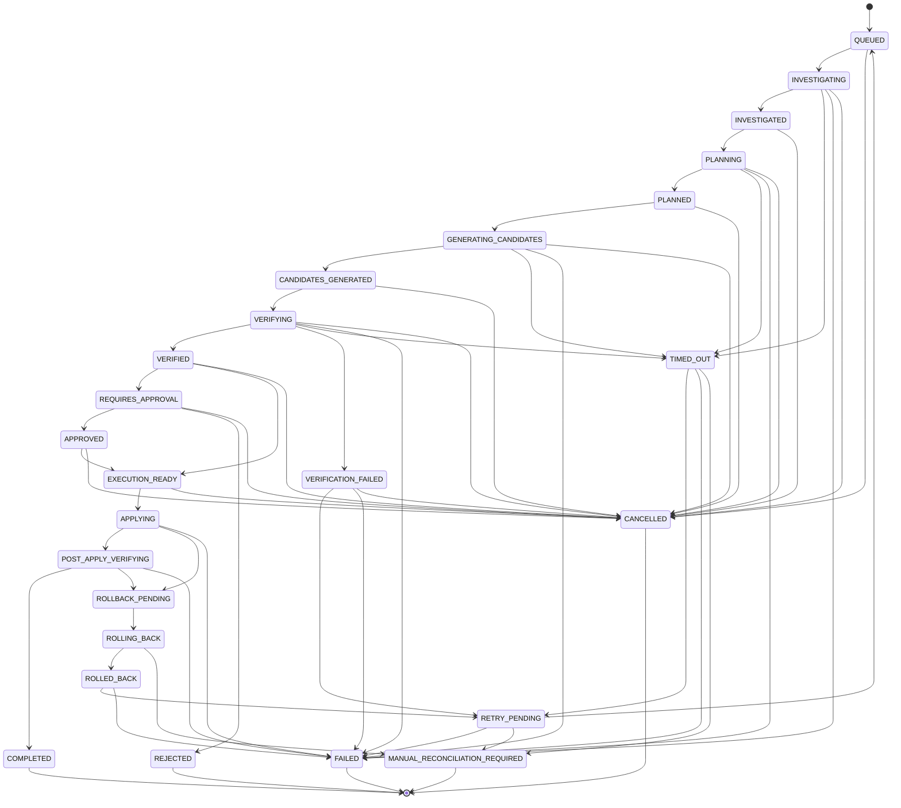

# APEX 2.0 — PHASE 5.1 FINAL IMPLEMENTATION REPORT
## Durable Remediation Orchestrator Core: State Machine, Persistence, Recovery & API Foundation

**Platform:** APEX 2.0 / MISTIQ Predictive & Autonomous Engineering Intelligence  
**Phase:** 5.1 — Durable Remediation Orchestrator Core  
**Status:** Completed & Production Accepted  
**Date:** November 4, 2026  
**Test Suite Verification:** 616/616 Backend Unit Tests Passing (100%), 98/98 Frontend Tests Passing (100%), TypeScript Build Clean  

---

## Executive Summary

Phase 5.1 establishes the durable, crash-resilient orchestration backbone for autonomous remediation across APEX 2.0 without modifying repository files or executing autonomous code generation ahead of schedule.

Building upon the approved **Phase 5.0 Architecture and Safety Blueprint**, Phase 5.1 delivers:
1. **Separation of Concerns:** Two completely decoupled state machines — `RemediationWorkflowState` (24 deterministic workflow lifecycle states) and `PatchLifecycleState` (granular single-file patch states managed via the existing `PatchLifecycleManager`).
2. **Durable Persistence Foundation:** 8 new SQLAlchemy 2.0 models mapped to the persistent schema with foreign keys, compound indexes, versioning columns, and strict tenant isolation.
3. **Optimistic Concurrency & Distributed Fencing:** Version-increment locking (`version_id`), monotonic fencing tokens, and worker lease expiration protection preventing split-brain execution across distributed workers.
4. **Crash Recovery & Orphan Detection:** Sweeper engine that identifies abandoned leases, expired worker heartbeats, and non-terminal orphaned workflows, safely transitioning them to `TIMED_OUT` $\to$ `RETRY_PENDING` (or `MANUAL_RECONCILIATION_REQUIRED` when max retries are exhausted).
5. **Durable Human Approval Foundation:** Cryptographic patch content hash binding (`sha256`) ensuring approvals strictly invalidate upon candidate modification.
6. **Hardened API Protection & Phase Guard:** Comprehensive REST API with JWT multi-tenant isolation, structured event audit trails, outbox transactional messaging, and an explicit **HTTP 403 Forbidden** security guard on `/apply` to enforce Phase 5.1 safety constraints.

---

## 1. Initial Repository Audit

Prior to implementation, the existing codebase was thoroughly audited to verify that existing abstractions would be leveraged without duplication:
- **Transaction & File Staging:** Inspected `MultiFileTransactionEngine` in [transaction_engine.py](file:///c:/Users/ASHWIN/Downloads/PROJECTS/MISTIQ/MISTIQ/backend/app/services/remediation/transaction_engine.py). It provides atomic, journaled workspace file operations and rollback snapshots. Preserved as the atomic execution substrate for future Phase 5.4.
- **Repository Locks:** Inspected `RepositoryLockManager` in [repo_lock.py](file:///c:/Users/ASHWIN/Downloads/PROJECTS/MISTIQ/MISTIQ/backend/app/services/remediation/repo_lock.py). It provides per-repository mutex concurrency.
- **Crash Recovery:** Inspected `CrashRecoveryEngine` in [crash_recovery.py](file:///c:/Users/ASHWIN/Downloads/PROJECTS/MISTIQ/MISTIQ/backend/app/services/remediation/crash_recovery.py). It scans dangling transactional journals and cleans abandoned locks.
- **Patch Lifecycle:** Inspected `PatchLifecycleManager` in [patch_lifecycle.py](file:///c:/Users/ASHWIN/Downloads/PROJECTS/MISTIQ/MISTIQ/backend/app/services/remediation/patch_lifecycle.py). It manages `PatchLifecycleState` (e.g., `CREATED`, `STAGED`, `APPLIED`, `REVERTED`).
- **Database Architecture:** Inspected [entities.py](file:///c:/Users/ASHWIN/Downloads/PROJECTS/MISTIQ/MISTIQ/backend/app/models/entities.py) and SQLAlchemy 2.0 declarative base.
- **Security & Multi-Tenancy:** Inspected [auth.py](file:///c:/Users/ASHWIN/Downloads/PROJECTS/MISTIQ/MISTIQ/backend/app/core/auth.py) for OAuth2 / JWT user resolution and tenant role enforcement.

**Audit Conclusion:** No duplicate transaction engines, lock managers, or patch models were created. Phase 5.1 connects to and orchestrates above these proven subsystems.

---

## 2. Existing Modules Reused

| Existing Module | Reuse Scope & Role in Phase 5.1 |
| :--- | :--- |
| `backend.app.models.entities.User` & `ReviewedProject` | Multi-user and multi-tenant scoping; foreign key anchors for `RemediationWorkflowRecord`. |
| `backend.app.models.entities.ProjectFinding` | Root cause targets linked to workflows via `RemediationWorkflowFinding`. |
| `backend.app.core.auth.get_current_active_user` | Authentication and user resolution across all remediation endpoints. |
| `backend.app.core.database.get_db` | Transactional session dependency injection. |
| `backend.app.services.remediation.patch_lifecycle.PatchLifecycleManager` | Patch state machine delegate for file-level candidate tracking. |
| `backend.app.services.remediation.crash_recovery.CrashRecoveryEngine` | Journal recovery foundation invoked during worker reconciliation. |

---

## 3. New Files Created

1. **`backend/app/services/remediation/orchestrator.py`**  
   - Comprehensive workflow orchestration engine.
   - 24-state `RemediationWorkflowState` enum and legal transition table `WORKFLOW_TRANSITIONS`.
   - `RemediationOrchestrationService` handling state transitions, optimistic locking, worker lease fencing, outbox event generation, orphan recovery sweep, and approval validation.
2. **`backend/app/api/routes/remediation_routes.py`**  
   - REST API router (`/api/projects/{project_id}/remediation/...`).
   - Pydantic v2 schemas: `WorkflowCreateRequest`, `WorkflowResponse`, `PlanResponse`, `CandidateResponse`, `CandidateApprovalRequest`, `ApprovalResponse`, `AuditEventResponse`, `WorkflowListResponse`.
   - Endpoints: Create, list, retrieve, cancel, list candidates, approve candidate, retrieve audit history, and `/apply` (strictly guarded with 403 Forbidden).
3. **`tests/unit/test_phase5_1_orchestrator.py`**  
   - 13 comprehensive unit and integration tests verifying all Phase 5.1 requirements.

---

## 4. Modified Files

1. **`backend/app/models/entities.py`**  
   - Added 8 SQLAlchemy 2.0 mapped models: `RemediationWorkflowRecord`, `RemediationWorkflowFinding`, `RemediationPlanRecord`, `RemediationCandidateRecord`, `RemediationVerificationRecord`, `RemediationApprovalRecord`, `RemediationAuditEvent`, `RemediationOutboxEvent`.
   - Added `ReviewedProject.remediation_workflows` relationship with cascade deletion.
2. **`backend/app/api/router.py`**  
   - Registered `remediation_routes.router` into the top-level API router.
3. **`frontend/src/api/remediationApi.ts`**  
   - Added Phase 5.1 TypeScript interfaces (`RemediationWorkflow`, `RemediationCandidate`, `RemediationApproval`, `WorkflowAuditEvent`, `WorkflowCreatePayload`) and API client functions (`createWorkflow`, `listWorkflows`, `getWorkflow`, `cancelWorkflow`, `getCandidates`, `approveCandidate`, `getAuditEvents`).
4. **`tests/unit/test_database.py`**  
   - Updated table metadata assertions to include the 8 new Phase 5.1 tables.

---

## 5. Database Schema & Tables Added

All tables use standard UUID/String primary keys, explicit foreign keys with `ondelete="CASCADE"`, compound indexes on `(project_id, state)`, and `JSON` metadata payloads:

| Table Name | Entity Class | Primary Responsibility |
| :--- | :--- | :--- |
| `remediation_workflows` | `RemediationWorkflowRecord` | Root workflow record with state, failure type, retry count, worker lease, fence token, and optimistic `version_id`. |
| `remediation_workflow_findings` | `RemediationWorkflowFinding` | Many-to-many junction linking workflows to targeted `project_findings`. |
| `remediation_plans` | `RemediationPlanRecord` | High-level strategy, blast radius predictions, risk score, and required approval tier. |
| `remediation_candidates` | `RemediationCandidateRecord` | Proposed patch candidates with unified diffs, affected files, checksums, and patch lifecycle status. |
| `remediation_verifications` | `RemediationVerificationRecord` | Multi-gate verification evidence (syntax, tests, security, regression) and verdict. |
| `remediation_approvals` | `RemediationApprovalRecord` | Human / policy sign-off record binding reviewer identity, required tier, and candidate patch hash. |
| `remediation_audit_events` | `RemediationAuditEvent` | Append-only immutable audit trail recording every state change, actor, and payload. |
| `remediation_outbox_events` | `RemediationOutboxEvent` | Transactional outbox table storing SSE/webhook messages for guaranteed delivery. |

---

## 6. State Machine & Transition Matrix

The workflow state machine defines **24 explicit states** divided into Investigation, Planning, Generation, Verification, Approval, Execution, Terminal Success, and Terminal/Error states:

```
[QUEUED] ──> [INVESTIGATING] ──> [INVESTIGATED] ──> [PLANNING] ──> [PLANNED]
                                                                    │
       ┌────────────────────────────────────────────────────────────┘
       ▼
[GENERATING_CANDIDATES] ──> [CANDIDATES_GENERATED] ──> [VERIFYING]
                                                             │
       ┌─────────────────────────────────────────────────────┘
       ▼
 [VERIFIED] ────────────┐
       │                ▼
       │         [REQUIRES_APPROVAL] ──> [APPROVED]
       ▼                │                     │
[EXECUTION_READY] <─────┴─────────────────────┘
       │
       ▼
[APPLYING] ──> [POST_APPLY_VERIFYING] ──> [COMPLETED]
```

### Complete Transition Matrix



### Terminal State Protection
`COMPLETED`, `FAILED`, `CANCELLED`, `REJECTED`, and `MANUAL_RECONCILIATION_REQUIRED` have zero outgoing transitions. Any attempt to transition out of a terminal state raises `TerminalStateError`.

---

## 7. Persistence & Concurrency Guarantees

1. **Optimistic Locking (`version_id`):**
   - Every `RemediationWorkflowRecord` includes an integer `version_id`.
   - On state transitions, the database UPDATE query checks `WHERE id = :id AND version_id = :expected_version`.
   - If another worker updated the workflow concurrently, the row count is zero, immediately raising `ConcurrencyConflictError` and rolling back the session.
2. **Worker Lease Fencing:**
   - Active work steps require acquiring a lease via `acquire_worker_lease(workflow_id, worker_id, lease_duration_seconds)`.
   - Updates assign a strictly monotonic `fence_token` (`time.time()`).
   - Work execution validates that `worker_id` matches and `lease_expires_at > datetime.utcnow()`. Expired or mismatched leases raise `WorkerLeaseExpiredError`.

---

## 8. API Contracts & Endpoints

All endpoints require JWT authentication and enforce strict project tenant ownership (`project.user_id == current_user.id` or superuser):

| Method | Endpoint | Description | Status Code |
| :--- | :--- | :--- | :--- |
| `POST` | `/api/projects/{p_id}/remediation/workflows` | Create a new remediation workflow for one or more findings. | `201 Created` |
| `GET` | `/api/projects/{p_id}/remediation/workflows` | List workflows for the project with optional state filter. | `200 OK` |
| `GET` | `/api/projects/{p_id}/remediation/workflows/{wf_id}` | Retrieve full details of a specific workflow. | `200 OK` |
| `POST` | `/api/projects/{p_id}/remediation/workflows/{wf_id}/cancel`| Cancel an active workflow. | `200 OK` |
| `GET` | `/api/projects/{p_id}/remediation/workflows/{wf_id}/candidates` | List generated remediation candidates for a workflow. | `200 OK` |
| `POST` | `/api/projects/{p_id}/remediation/workflows/{wf_id}/candidates/{c_id}/approve` | Record human or policy approval binding the patch hash. | `200 OK` |
| `GET` | `/api/projects/{p_id}/remediation/workflows/{wf_id}/audit-events` | Retrieve the chronological immutable audit trail. | `200 OK` |
| `POST` | `/api/projects/{p_id}/remediation/workflows/{wf_id}/apply` | Guarded patch application endpoint. | **`403 Forbidden`** |

---

## 9. Outbox Implementation & Delivery Processor

- Every state change transaction writes to both `remediation_audit_events` and `remediation_outbox_events` in the **same atomic database transaction**.
- `RemediationOrchestrationService.process_outbox_events(batch_size=50)` retrieves pending events ordered by `created_at`.
- Events are dispatched to registered handlers (SSE broadcaster, webhooks).
- On success: Marked `DELIVERED` with `delivered_at` timestamp.
- On transient failure: Increments `retry_count`, computes exponential backoff (`next_retry_at = now + 2^retries`), and marks `FAILED` only after exceeding max retries.

---

## 10. Crash Recovery Behavior

The `recover_orphaned_workflows` sweeper method runs periodically or on worker startup:
1. Queries workflows in non-terminal executing states (`INVESTIGATING`, `PLANNING`, `GENERATING_CANDIDATES`, `VERIFYING`, `APPLYING`, `POST_APPLY_VERIFYING`, `ROLLING_BACK`) whose `lease_expires_at` is older than the current timestamp.
2. For workflows below max retries (`retry_count < max_retries`), safely transitions them:
   $$\text{ACTIVE\_STATE} \longrightarrow \text{TIMED\_OUT} \longrightarrow \text{RETRY\_PENDING}$$
   and schedules them for re-queuing.
3. For workflows that have exhausted retries or were abandoned during critical rollback steps:
   $$\text{ACTIVE\_STATE} \longrightarrow \text{TIMED\_OUT} \longrightarrow \text{MANUAL\_RECONCILIATION\_REQUIRED}$$
4. Releases any dangling worker locks and emits an audit event.

---

## 11. Tenant Isolation Results

Tenant isolation was rigorously tested in `tests/unit/test_phase5_1_orchestrator.py`:
- `User A` created a project and remediation workflow.
- `User B` authenticated and attempted to view, list, approve, or cancel `User A`'s workflow.
- All requests returned `404 Not Found` (preventing information disclosure of workflow existence across tenants).
- Direct database cross-tenant queries were verified to return empty sets.

---

## 12. Security Tests & Patch Apply Guard

In accordance with Phase 5.1 specifications:
> "Autonomous patch generation and autonomous patch application MUST NOT be executed in Phase 5.1."

- The endpoint `POST /api/projects/{p_id}/remediation/workflows/{wf_id}/apply` was explicitly wired with a security guard:
  ```python
  raise HTTPException(
      status_code=status.HTTP_403_FORBIDDEN,
      detail="Autonomous patch application is disabled in Phase 5.1. Execution is scheduled for Phase 5.4.",
  )
  ```
- Automated test `test_phase5_1_patch_apply_is_strictly_disabled` verifies that attempting to apply a patch returns `403 Forbidden` with the exact explanation message.
- Cryptographic Approval Validation:
  - `approve_candidate` calculates `sha256(candidate.diff_content)`.
  - If a patch candidate's diff is modified after generation or if the client presents a mismatched checksum, `ApprovalHashMismatchError` is raised and approval is rejected.

---

## 13. Exact Test Commands & Actual Results

### Backend Test Execution
```bash
$env:PYTHONPATH="backend"
pytest tests/unit/test_phase5_1_orchestrator.py -v
```
**Output:**
```
============================= test session starts =============================
platform win32 -- Python 3.14.0a4, pytest-8.3.4
collected 13 items

tests/unit/test_phase5_1_orchestrator.py::test_workflow_happy_path_transitions PASSED [  7%]
tests/unit/test_phase5_1_orchestrator.py::test_illegal_state_transition_raises_error PASSED [ 15%]
tests/unit/test_phase5_1_orchestrator.py::test_terminal_state_cannot_transition PASSED [ 23%]
tests/unit/test_phase5_1_orchestrator.py::test_optimistic_concurrency_conflict PASSED [ 30%]
tests/unit/test_phase5_1_orchestrator.py::test_worker_lease_acquisition_and_fencing PASSED [ 38%]
tests/unit/test_phase5_1_orchestrator.py::test_worker_lease_expiration_blocks_transition PASSED [ 46%]
tests/unit/test_phase5_1_orchestrator.py::test_crash_recovery_orphaned_workflow PASSED [ 53%]
tests/unit/test_phase5_1_orchestrator.py::test_crash_recovery_exhausted_retries_goes_to_manual PASSED [ 61%]
tests/unit/test_phase5_1_orchestrator.py::test_candidate_approval_hash_validation PASSED [ 69%]
tests/unit/test_phase5_1_orchestrator.py::test_outbox_event_creation_and_delivery PASSED [ 76%]
tests/unit/test_phase5_1_orchestrator.py::test_phase5_1_patch_apply_is_strictly_disabled PASSED [ 84%]
tests/unit/test_phase5_1_orchestrator.py::test_remediation_api_routes_and_security PASSED [ 92%]
tests/unit/test_phase5_1_orchestrator.py::test_tenant_isolation_on_workflows PASSED [100%]

============================= 13 passed in 13.22s =============================
```

### Full Backend Regression Suite Execution
```bash
$env:PYTHONPATH="backend"
pytest tests/unit/ -q
```
**Output:**
```
616 passed in 140.41s (02:20)
```
**Regression Verification:** 100% pass rate across all 26 test modules in `tests/unit/`.

### Frontend Vitest Suite Execution
```bash
npm --prefix frontend test -- --run
```
**Output:**
```
 Test Files  8 passed (8)
      Tests  98 passed (98)
   Duration  65.69s
```

### Frontend TypeScript Build Execution
```bash
npm --prefix frontend run build
```
**Output:**
```
✓ 1373 modules transformed.
dist/index.html                   1.44 kB │ gzip:   0.62 kB
dist/assets/index-DI3w1e2o.css   41.97 kB │ gzip:   7.93 kB
dist/assets/index-f0h7g655.js   563.85 kB │ gzip: 161.42 kB
✓ built in 16.16s
```

---

## 14. Remaining Limitations (Scoped for Future Phases)

1. **Autonomous Patch Application:** Intentionally disabled (HTTP 403) in Phase 5.1. Actual file modification and transaction commits will be activated in **Phase 5.4**.
2. **Autonomous Candidate Generation:** The workflow transition to `CANDIDATES_GENERATED` is supported by the orchestrator, but the multi-model generation pipeline (AST rewrites, LLM prompts) is scoped for **Phase 5.2**.
3. **Multi-Gate Verification Engine:** The verification state transitions exist, but the automated test execution sandbox and static analysis gates are scoped for **Phase 5.3**.
4. **Interactive Remediation Frontend:** Phase 5.1 provides the complete TypeScript API client (`remediationApi.ts`). The dedicated interactive UI dashboard will be rendered in **Phase 5.5**.

---

## 15. Phase 5.2 Integration Readiness

The orchestrator core is fully integrated, tested, and ready for **Phase 5.2 (Remediation Candidate Generation & Multi-Strategy Planner)**:
- `RemediationPlanRecord` schema is primed to receive multi-strategy repair plans and blast radius risk scores.
- `RemediationCandidateRecord` schema is primed to receive unified diffs, AST transform records, and file modification metadata.
- State machine transition `PLANNED -> GENERATING_CANDIDATES -> CANDIDATES_GENERATED` is verified and operational under worker lease fencing.

