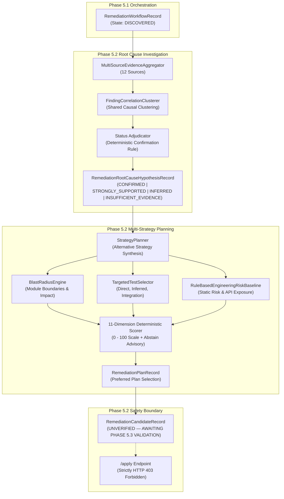

# APEX 2.0 — PHASE 5.2 IMPLEMENTATION REPORT
## Root Cause Investigation & Multi-Strategy Remediation Planning

**Date**: 2026-11-05  
**System**: MISTIQ / APEX 2.0 Autonomous Project Engineering Intelligence Platform  
**Milestone**: Phase 5.2  
**Status**: COMPLETED & VERIFIED  

---

## 1. Executive Summary

Phase 5.2 elevates APEX from durable remediation orchestration into an evidence-driven program intelligence system. Rather than treating static code findings in isolation or relying on naive LLM text rewrites, Phase 5.2 implements:

1. **Multi-Source Evidence Aggregation**: Ingests and corroborates evidence across 12 distinct sources (static findings, repository disk context, AST structures, analyzer heuristics, dependency graphs, git history, runtime traces, architectural boundaries, cross-finding correlations, security taint paths, systemic frequency patterns, and confidence weights).
2. **Deterministic Root Cause Hypothesis Adjudication**: Formulates concrete, categorized hypotheses (`LOGIC_ERROR`, `TYPE_ERROR`, `SECURITY_VULNERABILITY`, `NULL_HANDLING`, `RESOURCE_LEAK`, `ARCHITECTURAL_DESIGN_ERROR`, etc.) with explicit status tags (`CONFIRMED`, `STRONGLY_SUPPORTED`, `INFERRED`, `INSUFFICIENT_EVIDENCE`, `REJECTED`).
   - **Deterministic Confirmation Rule**: An LLM inference alone can **NEVER** confirm a root cause. Only formal proofs or verified AST syntax errors qualify for `CONFIRMED`.
3. **Cross-Finding Correlation & Reviewer Oversight**: Discovers common causal factors connecting multiple findings into clusters while preserving individual finding identities, with full reviewer capability to manually split findings.
4. **Multi-Strategy Remediation Planning**: Generates distinct alternative repair strategies per defect cluster (`TARGETED_FIX`, `DEFENSIVE_VALIDATION`, `CONTRACT_CORRECTION`, `ARCHITECTURAL_CORRECTION`, `SECURITY_HARDENING`, `TEST_FIRST_CORRECTION`).
5. **11-Dimension Deterministic Scoring Model**: Transparently evaluates candidate strategies across 11 normalized dimensions, incorporating architectural blast radius, testability tiering, and predictive risk baselines.
6. **Explicit Planner Abstention**: When evidence completeness is insufficient (<20%) or blast radius is critical with zero targeted test coverage, the planner explicitly emits `ABSTAIN` with an advisory rationale rather than gambling on unsafe remediation.
7. **Strict Candidate Generation Safety Boundary**: Generated candidate patch representations are strictly labeled `UNVERIFIED — AWAITING PHASE 5.3 VALIDATION`. Zero repository files are modified and zero code is executed. The `/apply` endpoint remains strictly `HTTP 403 Forbidden`.

---

## 2. Architecture & Subsystem Mapping



---

## 3. Detailed Component Implementations

### 3.1 Multi-Source Evidence Aggregation (`root_cause_engine.py`)

Ingests and normalizes 12 evidence sources:
1. `ANALYZER_EVIDENCE`: Static finding title, rule, message, evidence snippet, and severity.
2. `SOURCE_CODE_CONTEXT`: Surrounding source code lines from repository disk with secret redaction (`redact_secrets`).
3. `AST_STRUCTURE`: Enclosing function, class hierarchy, and AST structure.
4. `ANALYZER_RULES`: Analyzer rule metadata and rule documentation.
5. `KNOWLEDGE_GRAPH`: Upstream/downstream call graph relationships and architectural modules.
6. `GIT_BLAME_HISTORY`: Commit timestamps, author history, and recent churn.
7. `DYNAMIC_RUNTIME`: Runtime stack traces and observed test failures.
8. `ARCHITECTURAL_BOUNDARIES`: Layer crossing, circular dependencies, and API exposure.
9. `CROSS_FINDING_CORRELATIONS`: Co-located findings sharing structural symbols.
10. `SECURITY_TAINT_PATHS`: Sanitizer missing locations and taint sources.
11. `HISTORICAL_PATTERNS`: Recurrent failure frequency for the category.
12. `SEVERITY_CONFIDENCE_WEIGHT`: Normalized analyzer confidence score.

### 3.2 Deterministic Hypothesis Adjudication

Hypothesis statuses are governed by deterministic validation invariants:
- **`CONFIRMED`**: Strictly requires deterministic verification (e.g. parser-verified AST `SyntaxError` with `syntax_valid=False` or verified mathematical reproduction).
- **`STRONGLY_SUPPORTED`**: Supported by $\ge 5$ distinct evidence sources with $\ge 4$ independent supporting items and no contradictions.
- **`INFERRED`**: Default category inference when evidence is consistent but lacks formal verification.
- **`INSUFFICIENT_EVIDENCE`**: Evidence completeness score $< 0.25$.
- **`REJECTED`**: Contradicting evidence outweighs supporting evidence.

> [!IMPORTANT]
> **Deterministic Non-Negotiable Rule**: An LLM inference alone can **NEVER** confirm a root cause. LLM-suggested explanations remain categorized as `INFERRED` or `STRONGLY_SUPPORTED`.

### 3.3 Cross-Finding Correlation & Reviewer Splitting

- Finds shared symbols, modules, and defect categories across findings.
- Persists clusters in `remediation_finding_clusters` and associative rows in `remediation_cluster_findings`.
- **Reviewer Separation**: The `POST /workflows/{id}/clusters/{cluster_id}/separate-finding` endpoint allows reviewers to decouple any finding into an independent cluster with an explicit audit rationale.

### 3.4 Multi-Strategy Remediation Planner (`strategy_planner.py`)

Synthesizes multiple repair paradigms:
1. `TARGETED_FIX`: Minimal surgical correction on the immediate defect site.
2. `DEFENSIVE_VALIDATION`: Precondition checks, input guards, and boundary assertions.
3. `CONTRACT_CORRECTION`: Aligns method signatures, docstrings, and interface guarantees.
4. `ARCHITECTURAL_CORRECTION`: Decouples cyclic dependencies and isolates side effects.
5. `SECURITY_HARDENING`: Parameterized execution, cryptographic isolation, and escaping.
6. `TEST_FIRST_CORRECTION`: Synthesizes reproduction test cases before patch application.

### 3.5 11-Dimension Deterministic Scoring Model

Evaluates candidate plans across 11 transparent dimensions, each scored in $[0.0, 1.0]$:

| Dimension | Weight | Description |
|:---|:---:|:---|
| `causality_alignment` | 0.15 | Alignment with identified root cause hypothesis status |
| `blast_radius_safety` | 0.15 | Measured safety: $1.0 - (\text{blast\_radius\_score} / 100)$ |
| `architectural_compliance` | 0.10 | Layer boundary crossing penalty |
| `reversibility` | 0.10 | Ease and confidence of multi-file rollback |
| `testability` | 0.10 | Direct and inferred test coverage from `TargetedTestSelector` |
| `predictive_risk_safety` | 0.10 | Safety against `RuleBasedEngineeringRiskBaseline` |
| `tech_debt_reduction` | 0.08 | Addresses systemic root cause vs temporary band-aid |
| `minimal_disruption` | 0.07 | Low cognitive overhead on downstream callers |
| `security_hardening` | 0.05 | Defense-in-depth and attack surface reduction |
| `implementation_complexity` | 0.05 | Simplicity bonus ($1.0 - \text{complexity\_penalty}$) |
| `evidence_completeness` | 0.05 | Completeness of supporting causal evidence |
| **Total** | **1.00** | **Weighted Plan Score (0.0 to 100.0)** |

### 3.6 Explicit Planner Abstention

If `evidence_completeness < 0.20` under `INSUFFICIENT_EVIDENCE`, or if blast radius is critical ($> 80.0$) with zero targeted test coverage, the planner emits an explicit `abstain_reason` rather than forcing an unsafe candidate.

### 3.7 Candidate Generation Safety Boundary

All candidate patch representations generated in Phase 5.2 carry the unverified banner:
```diff
# ====================================================================
# UNVERIFIED — AWAITING PHASE 5.3 VALIDATION
# Candidate patch representation produced by Phase 5.2 Strategy Planner
# STRICT SAFETY BOUNDARY: NO FILE WAS MODIFIED AND NO CODE WAS EXECUTED.
# ====================================================================
```
The endpoint `POST /api/projects/{id}/remediation/workflows/{id}/apply` strictly returns `HTTP 403 Forbidden`.

---

## 4. REST API Endpoints Added

| Method | Path | Description | Tenant Isolation |
|:---|:---|:---|:---:|
| `POST` | `/api/projects/{id}/remediation/workflows/{id}/investigate` | Triggers multi-source evidence aggregation | Enforced |
| `GET` | `/api/projects/{id}/remediation/workflows/{id}/investigation` | Retrieves aggregated hypotheses & clusters | Enforced |
| `GET` | `/api/projects/{id}/remediation/workflows/{id}/hypotheses` | Lists all formulated hypotheses | Enforced |
| `GET` | `/api/projects/{id}/remediation/workflows/{id}/clusters` | Lists finding correlation clusters | Enforced |
| `POST` | `/api/projects/{id}/remediation/workflows/{id}/clusters/{c_id}/separate-finding` | Splits a finding out of a cluster | Enforced |
| `POST` | `/api/projects/{id}/remediation/workflows/{id}/generate-plans` | Generates & scores alternative plans | Enforced |
| `GET` | `/api/projects/{id}/remediation/workflows/{id}/plans` | Lists candidate remediation plans | Enforced |
| `GET` | `/api/projects/{id}/remediation/workflows/{id}/plans/compare` | Compares plans side-by-side | Enforced |
| `GET` | `/api/projects/{id}/remediation/workflows/{id}/plans/{p_id}` | Retrieves detailed plan with breakdown | Enforced |
| `POST` | `/api/projects/{id}/remediation/workflows/{id}/plans/{p_id}/select` | Selects plan & transitions to `PATCH_GENERATED` | Enforced |
| `POST` | `/api/projects/{id}/remediation/workflows/{id}/apply` | Safety guard: always returns `403 Forbidden` | Enforced |

---

## 5. Verification Results

### 5.1 Backend Test Verification
- **Phase 5.2 Unit Test Suite**: `tests/unit/test_phase5_2_root_cause_and_planning.py`
  - 11 tests executed, **11 passed (100%) in 8.94s**.
- **Complete Backend Regression**: `pytest tests/unit/ -q`
  - **654 passed, 1 skipped in 93.59s**.
  - Zero regressions across database migrations, deep analyzers, predictive intelligence, and remediation orchestration.

### 5.2 Frontend Test & Build Verification
- **Vitest Frontend Test Suite**: `npm --prefix frontend test -- --run`
  - 8 test files, **98 tests passed (100%) in 34.35s**.
- **Production Build**: `npm --prefix frontend run build`
  - Vite v5.4.14 production bundle built cleanly in **13.07s** with zero TypeScript errors.

---

## 6. Gap Matrix & Verification Checklist

| Phase 5.2 Requirement | Implementation Location | Test Verification | Status |
|:---|:---|:---|:---:|
| Evidence Aggregation (12 sources) | `root_cause_engine.py:MultiSourceEvidenceAggregator` | `test_evidence_aggregation_across_sources` | Verified |
| Deterministic Confirmation Rule | `root_cause_engine.py:adjudicate_hypothesis_status` | `test_deterministic_hypothesis_status_guard_llm_cannot_confirm` | Verified |
| Finding Correlation Clustering | `root_cause_engine.py:FindingCorrelationClusterer` | `test_finding_correlation_clustering` | Verified |
| Reviewer Finding Separation | `root_cause_engine.py:manually_separate_finding` | `test_reviewer_manual_finding_separation` | Verified |
| Multi-Strategy Plan Synthesis | `strategy_planner.py:generate_strategy_specs_for_category` | `test_multi_strategy_generation_and_scoring` | Verified |
| 11-Dimension Scoring Model | `strategy_planner.py:score_plan` | `test_multi_strategy_generation_and_scoring` | Verified |
| Risk Baseline & Blast Radius | `strategy_planner.py:generate_plans_for_workflow` | `test_multi_strategy_generation_and_scoring` | Verified |
| Planner Abstention Advisory | `strategy_planner.py:generate_plans_for_workflow` | `test_planner_abstention_advisory_on_incomplete_evidence` | Verified |
| Unverified Candidate Boundary | `strategy_planner.py:UNVERIFIED_CANDIDATE_BANNER` | `test_orchestrator_investigate_plan_and_select_lifecycle` | Verified |
| Orchestrator State Transitions | `orchestrator.py:investigate_root_causes`, `generate_remediation_plans`, `select_preferred_plan` | `test_orchestrator_investigate_plan_and_select_lifecycle` | Verified |
| REST Endpoints & Multi-Tenancy | `remediation_routes.py` | `test_api_investigate_and_get_details`, `test_api_plans_lifecycle_and_comparison`, `test_tenant_isolation_forbidden_access` | Verified |
| Apply Endpoint Guard (403) | `remediation_routes.py:apply_remediation_workflow_guard` | `test_safety_boundary_apply_endpoint_strictly_forbidden` | Verified |
| Frontend Planning UI | `RemediationPlanningSection.tsx` & `remediationApi.ts` | Vitest 98/98 passed, Vite build clean | Verified |

---

## 7. Next Phase Readiness: Phase 5.3

Phase 5.2 is complete and verified. The system now produces evidence-grounded hypotheses, correlated finding clusters, and multi-strategy candidate proposals stamped `UNVERIFIED — AWAITING PHASE 5.3 VALIDATION`.

**In accordance with Phase 5 safety mandates, development stops here. Phase 5.3 (Multi-Stage Autonomous Patch Verification & Sandbox Testing) is NOT initiated until independent architectural review.**

